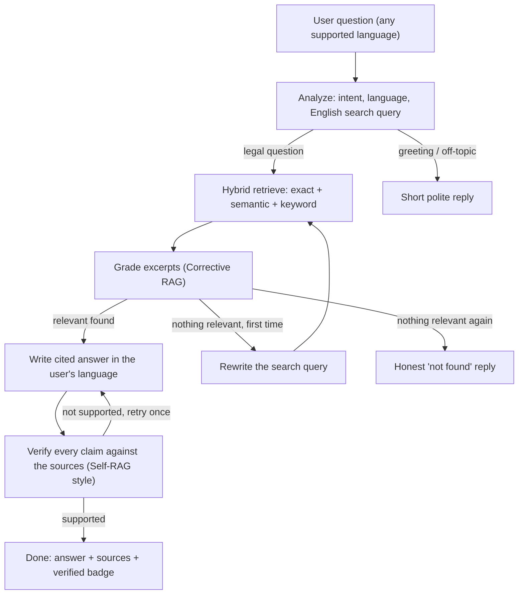
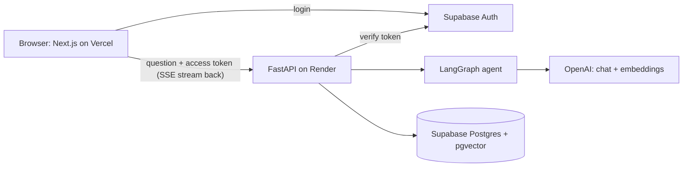

# ⚖️ Nyay AI

**A multilingual AI assistant that explains Indian law in your own language, and shows the exact sections it used.**

Ask a question in English, Hindi, Bengali, Marathi, Telugu, Tamil, Gujarati, Kannada or Malayalam. Nyay AI answers using only the **Bharatiya Nyaya Sanhita (BNS)**, the **Bharatiya Nagarik Suraksha Sanhita (BNSS)** and the **Constitution of India**, cites the sections, and checks its own answer against the source text before marking it as verified.

🔗 **Live demo:** `https://nyay-ai-rho.vercel.app/` 

<!-- Add a screenshot or GIF here, for example:  -->

> ⚠️ **Disclaimer:** Nyay AI gives general information about the law. It is not legal advice and does not replace a lawyer. For your own case, speak to a lawyer or your District Legal Services Authority.

---

## ✨ Features

- **Cited answers.** Every answer has inline `[1]`, `[2]` markers that open the exact source section (act, section number, title, page, text).
- **Answers that check themselves.** A LangGraph agent filters irrelevant excerpts, rewrites weak searches, and verifies each claim against the sources. The UI shows whether an answer was checked.
- **Hybrid search.** Exact section lookup ("Section 103 BNS", "Article 21") + semantic search (pgvector) + keyword search (Postgres full-text), merged with Reciprocal Rank Fusion.
- **Multilingual.** Questions are understood in any supported language, searched in English (the law text is English), and answered in the user's language. The answer language can also be chosen in the UI.
- **Private accounts.** Email sign-up and login with Supabase Auth. Every chat belongs to one user; nobody else can read or delete it.
- **Live streaming.** Answers appear word by word, with progress steps (understanding, searching, checking, writing, verifying).
- **Chat history.** Conversations are saved per user and can be reopened or deleted. Follow-up questions understand earlier messages.
- **Honest "not found".** If no provision matches, it says so instead of guessing. Off-topic questions get a polite refusal.

## 🧠 How it works



**Architecture**



**Why these choices**

| Decision | Reason |
|---|---|
| Section-level chunks | A legal answer must cite a real section. Chunks follow the Act's structure, long sections are split with overlap. |
| Hybrid retrieval | Meaning search finds "someone stole my phone"; keyword and exact lookup find "Section 303". Each fails where the other works. |
| Translate query to English | The law text is English, so keyword search would find nothing for a Hindi query. |
| Corrective + Self-RAG checks | In law, a confident wrong answer is worse than no answer. |
| History from the database | The graph stays stateless; the `messages` table is the single source of truth and is filtered per user. |
| No vector index at 3072 dimensions | pgvector can index only up to 2000 dimensions; exact search takes about 20 ms on a few thousand rows, so none is needed. |

## 🛠️ Tech stack

| Layer | Technology |
|---|---|
| Agent | LangGraph, LangChain |
| LLM and embeddings | OpenAI (`gpt-6-luna` chat, `text-embedding-3-small` with 1536 dimensions; both configurable) |
| Backend | Python 3.12, FastAPI, Server-Sent Events, psycopg 3 |
| Database and auth | Supabase: PostgreSQL, pgvector, Supabase Auth |
| Frontend | Next.js 16, React 19, TypeScript, Tailwind CSS 4, react-markdown |
| Deployment | Docker, Render (API), Vercel (web) |
| Tests | pytest (50 tests) |

## 🔒 Security and privacy

- Login tokens are verified on every request by asking Supabase who owns them; no secret to leak or misconfigure.
- Every database query is filtered by the logged-in user's id. Another user's chat returns "not found".
- Database tables are closed to Supabase's public API (row level security with no public policies); only the backend can read them.
- SQL is parameterised. Messages are limited to 1,500 characters. Each user is limited to 20 questions per 10 minutes.
- CORS allows only the configured website. Secrets live in environment variables and are git-ignored.

## 📁 Project structure

```
backend/
  app/
    main.py            API: /chat (streaming), /conversations, /health
    auth.py            login check and rate limit
    retrieval.py       exact + semantic + keyword search, RRF merge
    graph/             agent: nodes, prompts, builder, state
    ingestion/         PDF -> section chunks -> embeddings -> database
    check_setup.py     first-run checker
  sql/                 schema.sql, migrate_embedding_size.sql
  tests/               automated tests
  Dockerfile
frontend/
  src/app/             chat page and login page
  src/components/      Sidebar, MessageView (citations), Composer
  src/lib/             streaming API client, Supabase client, types
docs/SETUP_GUIDE.md    detailed beginner setup guide
```

## 🚀 Getting started

**Prerequisites:** Python 3.11+, Node.js 20.9+ (22 recommended), Git, an OpenAI API key, a free Supabase project.
A step-by-step beginner guide with screenshots-free click paths is in [`docs/SETUP_GUIDE.md`](docs/SETUP_GUIDE.md). The short version:

### 1. Database and login (Supabase)
1. Create a Supabase project.
2. In **SQL Editor**, run [`backend/sql/schema.sql`](backend/sql/schema.sql).
3. Copy the **Project URL**, the **anon/publishable key**, and the **Session pooler** connection string (Connect button).

### 2. Backend
```bash
cd backend
python -m venv .venv && source .venv/bin/activate      # Windows: .venv\Scripts\activate
pip install -r requirements.txt
cp .env.example .env                                   # fill in your values
python -m app.check_setup                              # every line should say [ OK ]
```

### 3. Load the law text
Download the **final Acts** (text PDFs, not Bills) from [India Code](https://www.indiacode.nic.in) or the Legislative Department and place them in `backend/data/`. PDFs are not stored in this repository.

```bash
python -m app.ingestion.ingest --act BNS --file data/bns.pdf --dry-run   # look first, nothing is saved
python -m app.ingestion.ingest --act BNS --file data/bns.pdf
python -m app.ingestion.ingest --act BNSS --file data/bnss.pdf
python -m app.ingestion.ingest --act Constitution --file data/constitution.pdf
```
A good dry run shows `Mode: sections`, 358 sections for BNS and 531 for BNSS with no gaps. The loader refuses Bills (their section numbers differ from the final law) and files where no section headings are found.

### 4. Run it
```bash
# terminal 1
cd backend && uvicorn app.main:app --reload --port 8000

# terminal 2
cd frontend && npm install && cp .env.local.example .env.local   # fill in values
npm run dev                                                        # open http://localhost:3000
```

## ⚙️ Configuration

**`backend/.env`**

| Variable | Meaning |
|---|---|
| `OPENAI_API_KEY` | Your OpenAI key |
| `OPENAI_CHAT_MODEL` | Chat model (default `gpt-4o-mini`) |
| `OPENAI_EMBEDDING_MODEL`, `OPENAI_EMBEDDING_DIMENSIONS` | Embedding model and size. Must match the `vector(N)` column in the database (default 3072) |
| `OPENAI_TEMPERATURE` | `0` for `gpt-4o-mini`; use `default` for reasoning models |
| `SUPABASE_URL`, `SUPABASE_ANON_KEY` | From Supabase project settings |
| `DATABASE_URL` | Supabase **Session pooler** connection string |
| `FRONTEND_ORIGINS` | Website URL(s) allowed to call the API |

**`frontend/.env.local`:** `NEXT_PUBLIC_SUPABASE_URL`, `NEXT_PUBLIC_SUPABASE_ANON_KEY`, `NEXT_PUBLIC_API_URL`.

Changing the embedding size later needs a database change: see [`backend/sql/migrate_embedding_size.sql`](backend/sql/migrate_embedding_size.sql). `check_setup` and the ingest command warn if the sizes disagree.

## ☁️ Deployment

- **API on Render:** Web Service, runtime **Docker**, root directory `backend`, health check `/health`, add the backend environment variables.
- **Web on Vercel:** import the repo, root directory `frontend`, add the three `NEXT_PUBLIC_*` variables.
- Set `FRONTEND_ORIGINS` on Render to your Vercel URL, and set the Supabase **Site URL** to the same.
- Free tiers: Render sleeps when idle (the first answer can take about a minute; the UI says so) and Supabase free projects can pause after inactivity.

## 🔌 API

All routes except `/health` need `Authorization: Bearer <Supabase access token>`.

| Method | Route | Purpose |
|---|---|---|
| GET | `/health` | Liveness check |
| GET | `/conversations` | List the user's chats |
| GET | `/conversations/{id}/messages` | Messages of one chat |
| DELETE | `/conversations/{id}` | Delete a chat |
| POST | `/chat` | Ask a question (`message`, optional `conversation_id`, optional `language`). Streams SSE events: `meta`, `status`, `token`, `reset`, `done`, `error` |

## ✅ Testing

```bash
cd backend
pip install -r requirements-dev.txt
pytest
```
Covers the agent's control flow (with a fake LLM), the search SQL on a real Postgres with pgvector, API behaviour and per-user privacy, login checks, embeddings configuration, and the PDF chunker (including text copied from the official BNS PDF). The API tests need a throwaway Postgres with `schema.sql` applied (set `TEST_DATABASE_URL`); never point them at your real database.

## 📌 Known limitations

- Only the BNS, BNSS and the Constitution are loaded. The Schedules (for example the BNSS offence classification) and the Statements of Objects are not.
- Answer quality in the regional languages depends on the OpenAI model and has not been formally evaluated.
- Stored text keeps some PDF noise (amendment markers like `1[...]`, page footnotes).
- The in-memory rate limiter resets when the server restarts.

## 🗺️ Roadmap

- [ ] Load the Schedules and clean amendment markers from stored text
- [ ] Evaluation set with native-speaker review per language
- [ ] Answer feedback (thumbs up/down) and analytics
- [ ] LangGraph checkpointer for in-graph memory and resumable runs
- [ ] Google login and a reranking step
- [ ] Move to a newer OpenAI chat model

## 👤 Author

**`Akansh Harlalka`**: [LinkedIn](https://linkedin.com/in/akansh-harlalka/) · [GitHub](https://github.com/ExWhyZed00/)

## 📄 License

`This project is open source and available under the MIT License.`

The law texts belong to the Government of India and are used for educational purposes.
